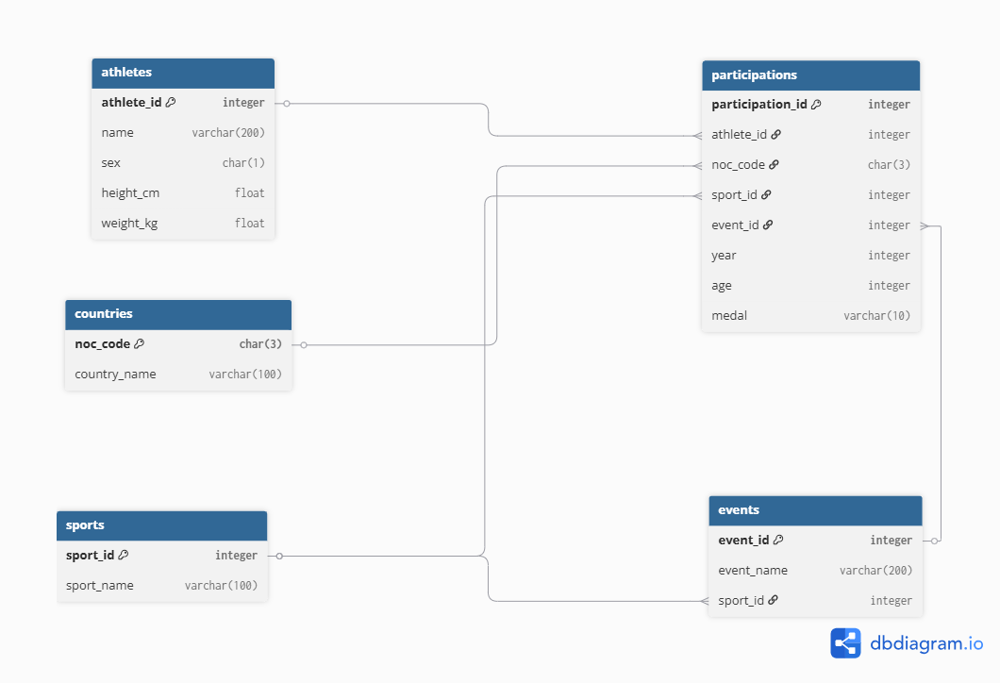
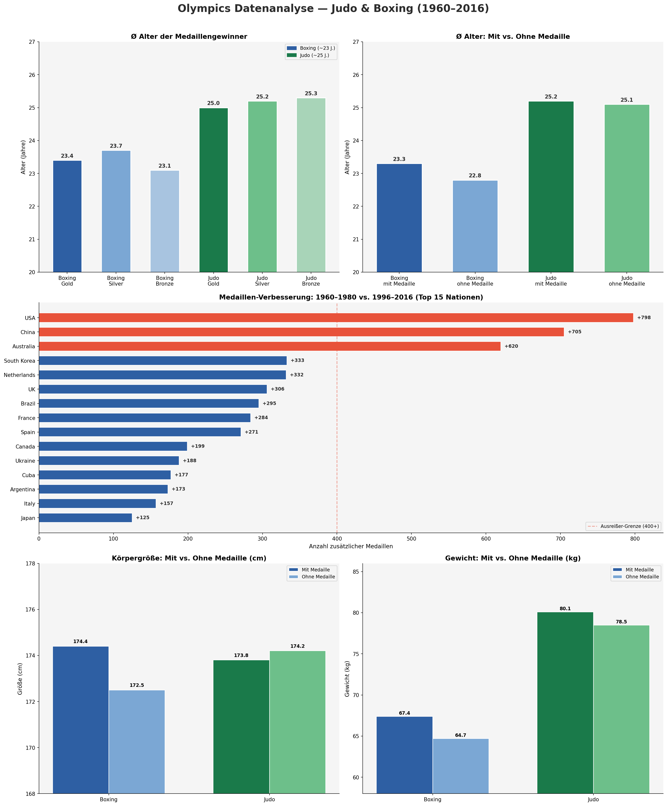

# Olympia-Fallstudie: Judo, Boxen und Nationen 1960 bis 2016

Fallstudie aus meiner Data-Analyst-Weiterbildung am Data Science Institute (06/2026),
als Einzelarbeit umgesetzt. Auftraggeber im Szenario ist die fiktive Firma SportsStats.
Ziel war es, aus Olympia-Daten Erkenntnisse für zwei Zielgruppen abzuleiten:
Elite-Personal-Trainer und lokale Nachrichtenredaktionen.

## Fragestellungen
1. In welchem Alter erreichen Boxer und Judokas ihren Medaillen-Höhepunkt?
2. Welche Nationen haben sich zwischen 1960 bis 1980 und 1996 bis 2016 am stärksten verbessert?
3. Unterscheiden sich Medaillengewinner im Körperbau von Athleten ohne Medaille?

## Daten
Grundlage ist eine CSV-Datei mit 216.784 Teilnahmen an Olympischen Spielen von
1904 bis 2016, die das Data Science Institute für die Fallstudie bereitgestellt hat.
Ich habe sie auf die Spiele ab 1960 gefiltert (165.978 Teilnahmen) und in fünf
Tabellen normalisiert. Die Daten selbst liegen nicht im Repository.

| Tabelle | Inhalt | Datensätze |
|---|---|---|
| athletes | Stammdaten der Athleten | 87.734 |
| countries | Nationale Olympische Komitees | 222 |
| sports | Sportarten ab 1960 | 36 |
| events | Wettkampfdisziplinen | 375 |
| participations | Faktentabelle, eine Zeile pro Teilnahme | 165.978 |



## Vorgehen
- **Datenmodell:** ERD entworfen, Tabellen in PostgreSQL 17 mit Primär- und
  Fremdschlüsseln angelegt. Für Medaillen habe ich einen ENUM-Typ verwendet, damit
  ungültige Werte schon in der Datenbank abgewiesen werden.
- **Import und Validierung:** Import in fester Reihenfolge wegen der Fremdschlüssel,
  danach Prüfung der Zeilenzahlen und der Beziehungen über JOIN-Abfragen.
- **Auswertung:** Kennzahlen per SQL, Aufbereitung in Excel, Berechnungen und
  Dashboard mit Python (pandas, NumPy, Matplotlib).

## Ergebnisse
- Boxer gewinnen ihre Medaillen im Schnitt mit 23,3 Jahren, Judokas mit 25,2 Jahren
  (nach Anzahl der Athleten gewichtet).
- Boxer mit Medaille sind im Schnitt 1,9 cm größer und 2,7 kg schwerer als Boxer ohne
  Medaille. Im Judo sind Medaillengewinner 0,4 cm kleiner, aber 1,6 kg schwerer.
- Die USA steigern sich von 795 auf 1.593 Medaillen, Australien von 197 auf 817.



## Grenzen der Analyse
- China (0 auf 705 Medaillen) und die Ukraine (0 auf 188) erscheinen als größte
  Aufsteiger. Beide nahmen im frühen Zeitraum aber gar nicht als eigenes Team an
  Sommerspielen teil. Der Vergleich misst bei ihnen also vor allem die Teilnahme.
- Medaillen sind pro Athlet gezählt. Mannschaftssportarten treiben die Zahlen
  dadurch nach oben.
- Größe und Gewicht fehlen in den frühen Jahrzehnten oft. Gewichtsklassen habe ich
  nicht getrennt ausgewertet.

## Herausforderungen
Beim Import blieben die Tabellen zunächst leer, weil die CSV-Dateien mit Semikolon
statt Komma getrennt waren. Die Original-ID konnte nicht Primärschlüssel werden, da
ein Athlet mehrere Wettkämpfe bestreitet. Leere Medaillenfelder passten nicht zum
ENUM-Typ, ich habe sie beim Normalisieren mit `None` gefüllt. Schlussfolgerungen und
Empfehlungen für beide Zielgruppen stehen in
[docs/Schlussfolgerungen_Empfehlungen.pdf](docs/Schlussfolgerungen_Empfehlungen.pdf).

## Projektstruktur
```
sql/          Tabellen anlegen, Daten importieren, Validierung
analyse/      Python-Skript und Excel-Auswertungen
ergebnisse/   Ergebnistabellen als CSV
images/       ERD und Dashboard
docs/         Schlussfolgerungen und Empfehlungen
```

## Werkzeuge
PostgreSQL 17, pgAdmin, SQL, Excel, Python (pandas, NumPy, Matplotlib)
